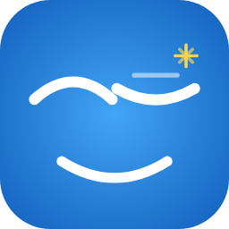

# JITAI Wizard -- Control Station

<p align="center">
  
</p>

<p align="center">
  <b>Latest release:</b> <a href="https://github.com/RBurchard/JITAI-WizardControlStation/releases">v2.1.0-beta</a> &middot; Windows x64 (.NET runtime bundled)
</p>

_The researcher-facing desktop application for running intervention studies with the JITAI Wizard wearable system._
_Project for the Bachelor of Science in the University of Siegen_

---

> **Maintenance note:** This file is the authoritative reference for the ControlStation project. If you change a screen, an endpoint call, a database table, a UI control, or a build target, update the relevant section here before merging. If you believe something new is to be added to the contents, go for it.

---

## Table of Contents

1. [Overview](#overview)
2. [Download & Install](#download--install)
3. [System Architecture](#system-architecture)
4. [Requirements](#requirements)
5. [Building the Project](#building-the-project)
6. [Application Layout](#application-layout)
7. [Session Management](#session-management)
8. [Device Discovery and Connection](#device-discovery-and-connection)
9. [Participant Panel](#participant-panel)
10. [Intervention Controls](#intervention-controls)
11. [Trivia Editor](#trivia-editor)
12. [Data Storage](#data-storage)
13. [CSV Export](#csv-export)
14. [Communication Protocol Reference](#communication-protocol-reference)
15. [Known Limitations and Notes](#known-limitations-and-notes)

---

## Overview

ControlStation is the researcher-side desktop application for the JITAI Wizard platform. It runs on Windows and allows a researcher to observe participants during a study, trigger interventions on demand, and collect biometric data from up to two participants simultaneously.

The application connects to Android phones running the JITAI Wizard companion app. Each phone acts as a bridge to a Wear OS watch worn by a participant. ControlStation does not communicate with the watches directly -- all watch control flows through the phone.

For documentation on the Android phone and watch apps, see the [JITAI-WizardAndroid repository](https://github.com/RBurchard/JITAI-WizardAndroid).

---

## Download & Install

> Just want to run it? Grab the latest build from the [**Releases page**](https://github.com/RBurchard/JITAI-WizardControlStation/releases) -- the .NET 10 runtime is bundled, so nothing else needs installing.

1. Download **`JITAI-WizardControlStation-v2.1.0-beta-win-x64.zip`** from the Releases page.
2. Extract the ZIP anywhere (for example `C:\JITAI-Wizard`). Keep all files together -- the `.exe` needs the DLLs and `Assets`/`Database` folders beside it.
3. Run **`OcdWizard.ControlStation.exe`**.
4. On first launch, Windows SmartScreen may warn about an unrecognized app (the build is unsigned) -- click **More info → Run anyway**.

The database is created automatically at `%APPDATA%\OcdWizard\data.db` on first run.

**Requires Windows 10/11 x64.** The companion **Android + Wear OS apps** are required and released separately: [JITAI-WizardAndroid releases](https://github.com/RBurchard/JITAI-WizardAndroid/releases).

Prefer to build from source? See [Building the Project](#building-the-project).

---

## System Architecture

```
+------------------+           UDP 5280 (discovery)           +-------------------+
|  ControlStation  | <--------------------------------------> |   Android Phone   |
|  Windows / .NET  |           HTTP 8080 (control)            |   mobile module   |
|  Avalonia UI     | <--------------------------------------> |   Ktor server     |
+------------------+           WS 8080/stream (data)          +-------------------+
                                                                        |
                                                               Wearable Data Layer
                                                              (Google Play Services)
                                                                        |
                                                              +-----------------+
                                                              |  Wear OS Watch  |
                                                              |  wear module    |
                                                              |  Sensor service |
                                                              +-----------------+
```

ControlStation discovers phones by listening for UDP beacon broadcasts. Once connected to a phone, it sends intervention commands over HTTP and receives a continuous stream of watch sensor data over a WebSocket. All received data is stored in a local SQLite database and can be exported to CSV.

ControlStation never initiates Bluetooth or Wearable Data Layer communication. That is handled entirely by the Android phone app.

---

## Requirements

### Hardware

- A Windows PC connected to the same local Wi-Fi network as the participant's Android phone.
- One Android phone and Wear OS watch per participant (up to two participants supported simultaneously).

### Software

| Tool | Notes |
|------|-------|
| Visual Studio 2022 or later | Recommended for building and running the project. |
| .NET 10.0 SDK | Required; download from the Microsoft .NET site |
| Avalonia extension for VS | Optional but improves XAML preview support |

Instead of Visual Studio, you may also also VSCode with the C# and Avalonia extension.

The project targets `net10.0` and uses Windows-specific packaging features. Building on macOS or Linux is theoretically possible with the .NET SDK but has not been tested.

---

## Building the Project

1. Clone the repository:

```
git clone https://github.com/RBurchard/JITAI-WizardControlStation.git
```

2. Open `OcdWizard.ControlStation.sln` in Visual Studio 2022.

3. Restore NuGet packages (Visual Studio does this automatically on first open).

4. Set `OcdWizard.ControlStation` as the startup project if it is not already.

5. Build and run with F5 or the "Start" button.

The database file is created automatically on first launch at `%APPDATA%\OcdWizard\data.db`. No manual database setup is required.

### Key Dependencies

| Package | Version | Purpose |
|---------|---------|---------|
| Avalonia | 11.2.7 | Cross-platform UI framework |
| CommunityToolkit.Mvvm | 8.4.0 | MVVM base classes and source generators |
| Microsoft.Data.Sqlite | 9.0.5 | SQLite database driver |
| Dapper | 2.1.35 | Lightweight SQL query mapping |
| System.Text.Json | 9.0.5 | JSON serialization for HTTP and WebSocket |

---

## Application Layout

The main window has three regions:

**Top bar** -- Session controls. Contains a session name text field, a Start Session button (green), a Stop Session button (red), and a status message line. The Start button is disabled while a session is active; the Stop button is disabled when no session is running.

**Main content area** -- Two side-by-side participant panels (Participant 1 on the left, Participant 2 on the right). Each panel is independent and controls one device.

**Bottom toolbar** -- Export and utility actions. Contains an Export CSV button and a Manage Trivia button.

---

## Session Management

Before triggering any interventions or connecting to devices, a session must be started.

1. Enter a name in the Session Name field (default: "New Session").
2. Click "Start Session." A GUID is generated for the session and stored in the database along with the session name and start timestamp.
3. The two participant panels become active.
4. When the study is complete, click "Stop Session." The end timestamp is recorded in the database, and whatever is in the session notes box is saved with it (the box and its Save button are disabled once the session has ended, so notes typed during a run no longer need a separate click on Save).

Session data (sensor readings, interventions, responses) is associated with the current session ID throughout its lifetime. Stopping a session does not disconnect devices or discard buffered data.

---

## Device Discovery and Connection

Each participant panel handles its own device independently.

### Scanning

Click "Scan" in a participant panel. ControlStation opens a UDP listener on port 5280 and waits 3 seconds for beacon packets from JITAI Wizard phones on the local network. Each discovered device appears in the dropdown list as "Device Name (IP:Port)".

The phone broadcasts a beacon every 5 seconds automatically whenever the JITAI Wizard companion app is running. If no devices appear, confirm that:

- The phone and the PC are on the same Wi-Fi subnet.
- The JITAI Wizard companion app is open and running on the phone.
- No firewall is blocking UDP port 5280 on the PC.

### Connecting

Select a discovered device from the dropdown, or type an address manually into the IP field in the format `XXX.XXX.X.XXX` or `XXX.XXX.X.XX:8080`. Click "Connect."

ControlStation sends a GET request to `/status` on the device to verify it is reachable. On success, the status indicator turns green and a WebSocket connection is opened to `/stream` to begin receiving sensor data.

If the WebSocket drops for any reason, it automatically attempts to reconnect with a 3-second delay between attempts.

### Waking the Watch

Between runs the watch drops into a low-power profile after five quiet minutes: one sensor snapshot a minute, no motion sensors, heart rate only when the OS measures it anyway. Live sensors on the Control Station are therefore sparse until a run starts.

"Wake watch (5 min)" in the connection card (enabled once connected) sends `POST /watch/wake` to the phone, which relays it to the watch. The watch collects at full rate for five minutes, then idles again on its own unless a run has started in the meantime, in which case the run keeps it awake for as long as it runs. Use it while fitting the watch to check heart rate and motion before pressing Start.

### Disconnecting

Click "Disconnect" to close the HTTP and WebSocket connections for that participant. The session remains active and the other participant is unaffected.

---

## Participant Panel

Each participant panel shows the following information once connected:

### Biometric Display

| Field | Description |
|-------|-------------|
| Heart Rate | Current BPM from the watch, displayed as a progress bar (0 to 200) and a numeric readout |
| Delta X Accel | Change in X-axis acceleration between the two most recent sensor snapshots (orange bar) |
| Delta Y Accel | Change in Y-axis acceleration (cyan bar) |
| Delta Z Accel | Change in Z-axis acceleration (green bar) |

Acceleration deltas give a quick visual indication of movement without requiring the researcher to interpret raw values. The bars show absolute magnitude.

### Event Log

A scrollable log at the bottom of each panel records timestamped events for that participant during the session. Events include connection state changes, triggered interventions, and received responses. The log is display-only and is not persisted; it resets when the application is restarted.

---

## Intervention Controls

The intervention controls sit in the middle section of each participant panel.

### Game Type

Selects the micro-game to attach to the intervention. Options:

| Value | Description |
|-------|-------------|
| None | No game; the watch shows only the intervention message |
| STAND_STILL | Participant must hold the watch still for 10 seconds |
| TRIVIA | Multiple-choice question (see Trivia section below) |
| SIMON_SAYS | Color sequence memory game, 4 rounds |
| LOCK_PICKING | Three-stage precision game (hold still, swipe circle, tap timing) |

### Notification Type

Selects how the watch alerts the participant when the intervention arrives. Options:

| Value | Description |
|-------|-------------|
| VIBRATION1 | Single short vibration pulse |
| VIBRATION2 | Single long vibration pulse |
| SOUND | Notification tone |
| VIBRATION_SOUND | Vibration and sound together |

### Sending an Intervention

Click "TRIGGER OCD DISTRACTION" to send the intervention to the connected device. The phone receives the request via HTTP POST to `/trigger`, forwards it to the watch over the Wearable Data Layer, and the watch displays it immediately.

The intervention is logged to the database with a timestamp and the selected game and notification types.

### Stopping an Intervention

Click "Stop" to cancel any currently active intervention on the watch. This sends an intervention request with the type set to "CANCEL."

---

## Trivia Editor

Click "Manage Trivia" in the bottom toolbar to open the Trivia Editor dialog.

The left panel shows all saved trivia questions as a list. The right panel shows the edit form for whichever question is selected.

Each question has:
- A question text field (multi-line)
- Four answer fields (A, B, C, D)
- A radio button group to select which answer is correct

**Add** creates a new blank question and selects it for editing.

**Remove** deletes the selected question from the list.

**Save Locally** writes the current question list to the database. Nothing is sent to any device yet.

**Push to Devices** saves to the database and then sends the full question list to all currently connected devices via HTTP POST to `/trivia`. The phone stores the list and uses it when a TRIVIA intervention is triggered.

When a TRIVIA intervention is triggered from the participant panel, there is also an inline trivia form that appears in the panel itself. This allows sending a single one-off question without going through the Trivia Editor.

---

## Data Storage

All session data is stored in a SQLite database at:

```
%APPDATA%\OcdWizard\data.db
```

The database is created automatically on first launch. The schema contains the following tables:

### sessions

| Column | Type | Description |
|--------|------|-------------|
| id | TEXT | Session GUID (primary key) |
| started_at | INTEGER | Unix timestamp in milliseconds |
| ended_at | INTEGER | Unix timestamp in milliseconds, null if session is still active |
| notes | TEXT | Session name as entered by the researcher |

### participants

| Column | Type | Description |
|--------|------|-------------|
| id | TEXT | Participant GUID (primary key) |
| session_id | TEXT | Foreign key to sessions |
| label | TEXT | "P1" or "P2" |
| device_ip | TEXT | IP address of the connected phone |
| participant_key | TEXT | Researcher-assigned identifier (defaults to the GUID if not set) |

### watch_data

All sensor readings streamed from the watch are stored here. Every row is one snapshot.

| Column | Type | Description |
|--------|------|-------------|
| id | INTEGER | Auto-incremented primary key |
| participant_id | TEXT | Foreign key to participants |
| timestamp | INTEGER | Unix timestamp in milliseconds |
| heart_rate | REAL | BPM reading from the watch |
| accel_x | REAL | X-axis accelerometer (m/s²) |
| accel_y | REAL | Y-axis accelerometer (m/s²) |
| accel_z | REAL | Z-axis accelerometer (m/s²) |
| gyro_x | REAL | X-axis gyroscope (rad/s) |
| gyro_y | REAL | Y-axis gyroscope (rad/s) |
| gyro_z | REAL | Z-axis gyroscope (rad/s) |
| rot_w | REAL | Rotation quaternion W component |
| rot_x | REAL | Rotation quaternion X component |
| rot_y | REAL | Rotation quaternion Y component |
| rot_z | REAL | Rotation quaternion Z component |
| baro_hpa | REAL | Barometric pressure in hPa |
| light_lux | REAL | Ambient light in lux |
| step_count | INTEGER | Cumulative step count |

### interventions

| Column | Type | Description |
|--------|------|-------------|
| id | TEXT | Intervention GUID (primary key) |
| participant_id | TEXT | Foreign key to participants |
| sent_at | INTEGER | Unix timestamp in milliseconds |
| game_type | TEXT | Game type string or null |
| notification_type | TEXT | Notification type string |
| response | TEXT | Participant's response, null until received |
| reaction_time_ms | INTEGER | Time from send to response in milliseconds, null until received |

### experiment_runs

| Column | Type | Description |
|--------|------|-------------|
| id | TEXT | Run GUID (primary key) |
| experiment_id | TEXT | ID of the experiment configuration |
| participant_id | TEXT | Foreign key to participants |
| session_id | TEXT | Foreign key to sessions |
| started_at | INTEGER | Unix timestamp in milliseconds |
| ended_at | INTEGER | Unix timestamp in milliseconds, null if run is still active |

### distraction_runs

| Column | Type | Description |
|--------|------|-------------|
| id | TEXT | Distraction GUID (primary key) |
| experiment_run_id | TEXT | Foreign key to experiment_runs |
| event_id | TEXT | ID of the experiment event that triggered this distraction |
| intervention_id | TEXT | ID of the intervention delivered |
| started_at | INTEGER | Unix timestamp in milliseconds |
| ended_at | INTEGER | Unix timestamp in milliseconds, null until dismissed |
| response | TEXT | Participant response string |
| reaction_time_ms | INTEGER | Time from delivery to response in milliseconds |

### session_logs

Structured event log streamed from the phone in real time during experiment runs.

| Column | Type | Description |
|--------|------|-------------|
| id | INTEGER | Auto-incremented primary key |
| run_id | TEXT | Foreign key to experiment_runs |
| ts | INTEGER | Unix timestamp in milliseconds |
| source | TEXT | Origin of the log entry (e.g. "experiment", "trigger") |
| level | TEXT | Severity level (INFO, WARN, ERROR) |
| kind | TEXT | Event type string |
| payload_json | TEXT | JSON payload specific to the event kind |

### experiments

| Column | Type | Description |
|--------|------|-------------|
| id | TEXT | Experiment GUID (primary key) |
| name | TEXT | Researcher-assigned experiment name |
| json | TEXT | Full experiment configuration as JSON |
| version | INTEGER | Incremented on each save |
| updated_at | INTEGER | Unix timestamp in milliseconds of last save |
| source | TEXT | "pc" if saved from ControlStation, "phone" if synced from device |

### trivia_questions

| Column | Type | Description |
|--------|------|-------------|
| id | INTEGER | Auto-incremented primary key |
| question | TEXT | Question text |
| answer_a | TEXT | Answer option A |
| answer_b | TEXT | Answer option B |
| answer_c | TEXT | Answer option C |
| answer_d | TEXT | Answer option D |
| correct_index | INTEGER | Index of the correct answer (0=A, 1=B, 2=C, 3=D) |

---

## CSV Export

Click "Export CSV" in the top toolbar. A session picker dialog opens listing all sessions stored in the database with their date, name, participant identifiers, experiment names, and number of sensor samples.

Select the session you want to export and click "Export Selected." A save dialog opens to choose the output file path.

Numbers are always written with a decimal point, whatever the PC's regional settings. Replay Mode reads the same text when it opens a session from the databank. A file exported by an older build on a PC that uses a decimal comma has damaged sensor rows; Replay Mode skips those rows and shows how many next to the file name, and the session can simply be exported again from the databank.

The exported CSV contains six sections separated by blank lines:

**SESSION** -- metadata header: session ID, name, start time, end time, and participant identifiers.

**WATCH DATA** -- all sensor snapshots for the session, one row per snapshot. Columns: participant_label, participant_key, timestamp, heart_rate, accel_x, accel_y, accel_z, gyro_x, gyro_y, gyro_z, rot_w, rot_x, rot_y, rot_z, baro_hpa, light_lux, step_count.

**SESSION LOGS** -- structured experiment events received from the phone. Columns: id, run_id, ts, source, level, kind, payload_json.

**INTERVENTIONS** -- all interventions sent during the session. Columns: id, participant_label, participant_key, sent_at, game_type, notification_type, response, reaction_time_ms.

**EXPERIMENT RUNS** -- each experiment run started during the session. Columns: run_id, experiment_name, participant_label, started_at, ended_at.

**DISTRACTION RUNS** -- each distraction task triggered within a run. Columns: distraction_id, run_id, event_id, intervention_id, started_at, ended_at, response, reaction_time_ms.

If only one session exists in the database, the picker is skipped and the file dialog opens immediately.

---

## Communication Protocol Reference

### HTTP Endpoints Called by ControlStation

All HTTP requests use a 10-second timeout. The base URL is `http://{device-ip}:8080`.

| Method | Endpoint | Purpose |
|--------|----------|---------|
| GET | /status | Verify the device is reachable; returns watch connection state, session ID, uptime, last BPM |
| GET | /data | Returns session ID, participant label, last reaction time, last BPM, last action string |
| GET | /participant | Returns the current participant info stored on the phone |
| POST | /participant | Sets participant info (id, sessionId, label, deviceIp) on the phone |
| GET | /experiment | Pull the current experiment configuration (with ETag header for conflict detection) |
| PUT | /experiment | Push an updated experiment configuration to the phone |
| POST | /experiment/control | Send a run command: start, auto, pause, stop, next, prev |
| POST | /trigger | Send an InterventionRequest to the phone (forwarded to the watch) |
| POST | /trigger/fire | Fire a manual trigger event by trigger ID |
| POST | /watch/wake | Hold the watch at full sensor rate for `{"minutes": n}` without starting a run ("Wake watch" button) |
| GET | /logs?since=\{id\}&limit=\{n\} | Poll experiment log entries since a given log ID |
| GET | /trivia | Pull the current trivia question bank from the phone |
| POST | /trivia | Push the full trivia question list to the phone |

### WebSocket Connections

| Path | Direction | Purpose |
|------|-----------|---------|
| /stream | Phone → ControlStation | Continuous `WatchDataBatch` JSON objects at ~1 Hz; each batch contains all sensor snapshots accumulated since the last send. ControlStation inserts each batch into `watch_data`. |
| /events | Phone → ControlStation | `WsEnvelope` JSON objects for experiment state changes, log entries, trigger fires, run start/stop, and intervention start/finish. ControlStation uses these to populate `session_logs`, `experiment_runs`, and `distraction_runs`. |

Both WebSockets reconnect automatically with a 3-second delay if the connection drops.

### UDP Discovery

ControlStation listens on UDP port 5280 for 3 seconds when Scan is clicked. Phones broadcast to this port every 5 seconds. The expected payload format is:

```json
{"app": "JITAIWizard", "port": 8080, "name": "<device model>"}
```

Packets where `app` is not `"JITAIWizard"` are silently ignored.

### InterventionRequest JSON Format

Sent as the body of POST /trigger:

```json
{
  "notificationType": "VIBRATION1",
  "message": "Stop!",
  "durationMs": 30000,
  "gameType": "TRIVIA",
  "phoneTaskType": null,
  "triviaQuestion": {
    "id": 0,
    "question": "What is 2 + 2?",
    "answers": ["3", "4", "5", "6"],
    "correctIndex": 1
  }
}
```

`gameType` and `triviaQuestion` are null when no game is selected. `phoneTaskType` is reserved for future use.

---

## Known Limitations and Notes

- The application supports exactly two participants simultaneously. This is a design decision for the current study scope, not a hard technical limit.
- The HTTP server on the phone runs without authentication. Do not use this system on untrusted networks. For realsies.
- Intervention responses (what the participant chose or whether they completed a game) are received by the phone from the watch and stored on the phone side. ControlStation receives them via the `/events` WebSocket as `intervention-finished` envelopes, which are written to `distraction_runs`.
- Currently there is a 90% Failed Trigger chance due to a few comm failures.
